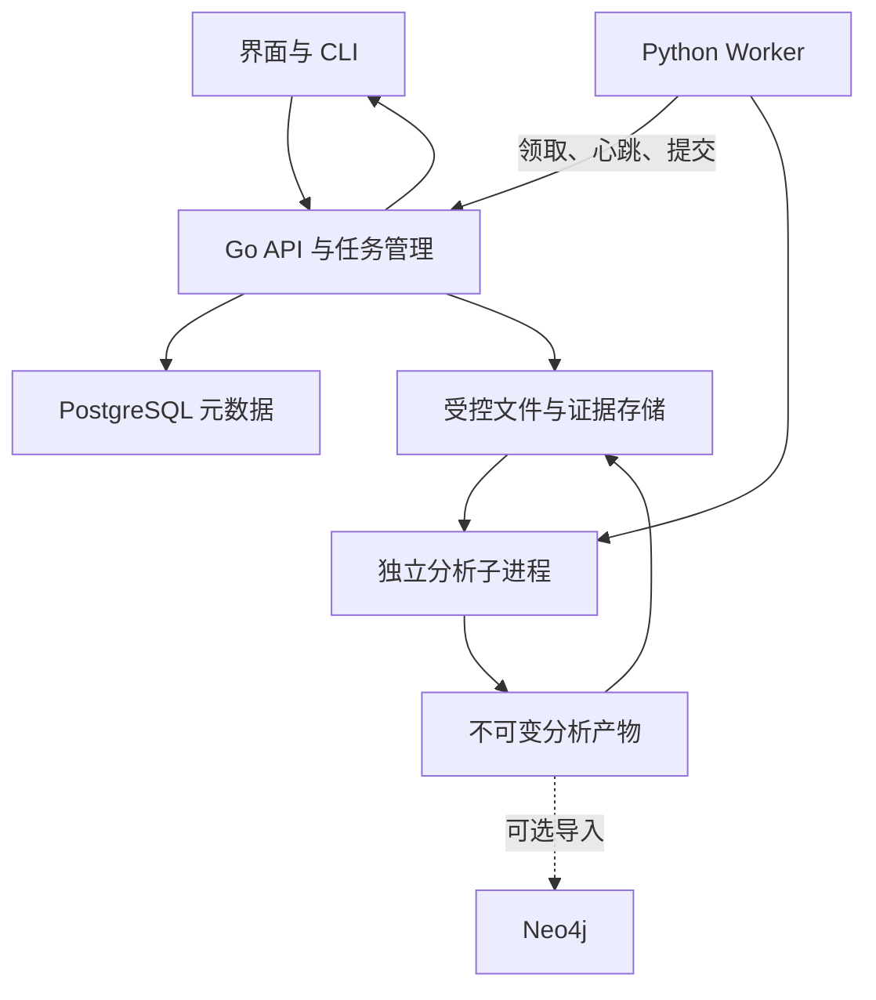
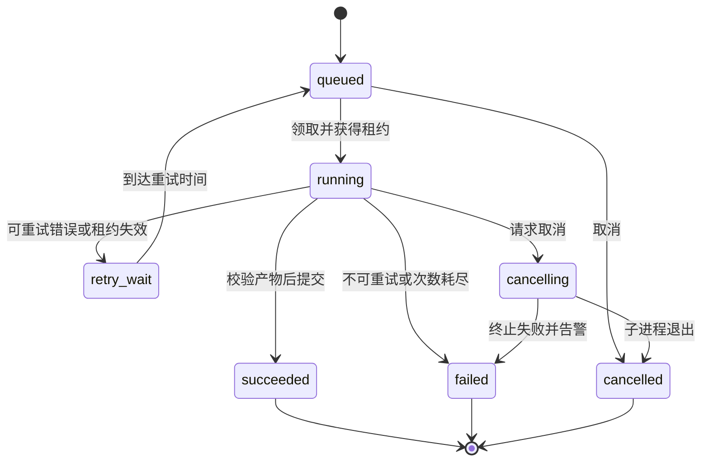

# CPAG 系统化重构方案

版本：v1.0（设计提案）
日期：2026-10-24（北京时间）
适用仓库：[TonyP4N/cpagx-go](https://github.com/TonyP4N/cpagx-go)
代码核查基线：[31f22b987928137b20ce131592117d57b0cb3ff4](https://github.com/TonyP4N/cpagx-go/tree/31f22b987928137b20ce131592117d57b0cb3ff4)
交付范围：架构、数据契约、模块迁移、实施顺序和验收方案。本文件不表示重构已实施，也不构成工业现场适用性证明。

## 1. 总体判断与重构目标

建议保留 Go、Python、TypeScript，采用渐进替换方式重构。先解决解析真实性、证据可追溯和评估独立性，再收敛任务系统与部署组件。暂不开展全量语言迁移。

第一阶段定位为“可在本地或隔离网络部署、联合分析网络流量与工艺数据的工业安全分析系统”，重点支持离线事件重建和按时间顺序的数据回放。未来旁路采集通过标准事件接口接入。

首个可验收能力是：针对一次网络操作，能够核查请求、响应、对应设备、相关工艺变化、推断依据和缺失信息。系统应允许得出“证据不足”，不以图的规模或连通程度作为质量目标。

### 1.1 已知条件、缺口和设计假设

| 类别 | 当前情况 | 对实施的影响 |
| --- | --- | --- |
| 用户条件 | 目前没有可接触的工厂；过去使用过新加坡大学提供的网络和工艺数据 | 先完成数据驱动的研究验证，现场试点单列 |
| 数据来源判断 | 仓库有 SWaT 设备映射和规则，推测原测试数据来自 SUTD/iTrust SWaT | 具体批次仍以原始文件和授权目录为准 |
| 本次已取得 | 18 份公开网页、论文、规则和架构资料，以及整理清单 | 可以准备适配器和实验设计 |
| 本次尚未取得 | 原始 PCAP/PCAPNG、Historian CSV/Excel、配套正式攻击记录 | 不能执行真实双源对齐或宣称准确率 |
| 工程现状 | 已有前端、Go 网关、Python V1/V2、队列和 Neo4j 实现 | 可以复用外部框架和部分功能 |
| 验证边界 | 已做代码核查和一项缺失方法的隔离复现，未启动整套服务 | 先建立可运行基线，不预设所有模块正常 |
| 首版设计假设 | 单站点、单机部署、有限并发；以 Linux x86_64 为首个验收环境 | 这些是本方案建议，客户环境出现后再调整 |

### 1.2 首版范围

包含：

- PCAP/PCAPNG 与工艺 CSV 的导入、校验、索引和版本管理。
- 优先支持经真实样本核验的 EtherNet/IP（ENIP）/CIP 操作子集。
- SWaT 批次配置、设备映射、时间对齐和数据质量报告。
- 基于规则和时序约束的事件关联，以及可追溯的图输出。
- 离线分析、连续回放、任务管理、图与时间线联合查看。
- 独立评估、异常处理、部署、备份及恢复。

暂不包含：

- 在线阻断、PLC 写入、控制策略修改及安全关键控制。
- 全工业协议覆盖、所有行业通用模型。
- 自动发现全部漏洞、自动生成完整潜在攻击路径。
- 大规模多租户、跨工厂集群和 Kubernetes 部署。
- 未经独立校准的攻击成功概率。
- 依赖大模型作出关键事实或因果判断。文字辅助可作为后续独立功能。

## 2. 现有实现的处理原则

| 代码或组件 | 处理方式 | 具体要求 |
| --- | --- | --- |
| Go API、配置和 CLI | 保留框架，重构职责 | 统一配置来源、错误模型、任务状态；移除固定 Python 容器地址 |
| Python V1/V2 处理入口 | 逐步收敛 | 保留兼容接口，计算转发到同一新核心 |
| V1 Scapy 解析 | 作为候选和比较基线 | 用同一组抓包验证字段一致性后决定保留范围 |
| V2 普通 PCAP 解析 | 优先替换 | 默认路径调用未定义方法；备用路径存在按包序号构造占位数据的逻辑 |
| unified_cpag_processor.py | 按职责拆分 | 文件识别、解析、匹配、建图、输出、存储分别独立 |
| event_matcher、confidence 模块 | 保留算法意图，重新验证 | 明确每项规则适用条件、输入依赖和分数含义 |
| SWaT 设备、阈值和规则 | 移入批次配置 | 核心代码不得默认 P101 等名称在所有场景成立 |
| Neo4j | 改为可选图查询适配器 | JSON 图输出和基础界面不依赖其在线状态 |
| Celery、RabbitMQ、Redis | 迁移期继续使用 | 分析核心稳定后，再替换任务承载；避免同时改算法和任务机制 |
| Next.js、Cytoscape | 保留并调整工作流 | 增加证据、时间线、未知状态和大图裁剪 |
| evaluation_* | 留档，拆出可复用度量 | 从输出中挑选 gold 的逻辑不能进入正式独立评估 |
| Compose、README、CI | 随阶段修订 | 文档示例必须在干净环境执行通过 |

本次确认的具体问题包括：V2 普通 PCAP 优化路径缺少解析方法、备用解析生成占位数据、部分 gold 构造依赖预测结果、V2 并发限制异常被捕获后继续执行，以及文档接口与实际路由不一致。它们分别对应解析、评估、任务和交付工作包，不扩大为“所有格式、所有版本均不可用”的结论。依据见第 16 节。

## 3. 目标架构与技术取舍

### 3.1 语言与职责

| 技术 | 目标职责 | 不承担的职责 |
| --- | --- | --- |
| Go | 对外 API、身份权限、任务调度、上传下载、审计和运行管理 | 工艺推断和实验算法快速迭代 |
| Python | 解析适配、标准事件处理、规则计算、事件关联、图生成及评估 | 直接修改公共任务状态和业务权限 |
| TypeScript | 数据集、任务、图、时间线及证据界面 | 客户端自行计算权威分析结论 |
| TShark | 候选报文解析工具，由适配层隔离 | 直接输出可信攻击结论 |
| PostgreSQL | 目标版本的任务、数据集、权限和审计元数据 | 储存全部原始报文字节及高频时序 |
| 本地受控文件存储 | 原始文件、分块事件、分析产物和证据索引 | 用文件名是否存在推断任务成功 |
| Neo4j | 可选的复杂图查询、探索与导出适配 | 作为分析核心唯一输出格式 |

目标基础部署建议收敛为三个常驻服务：Go 服务（同时提供静态前端）、Python Worker、PostgreSQL。Python Worker 为每次任务启动独立分析子进程。Neo4j 与监控面板按需启用。

PostgreSQL 是本方案新增的明确成本，用于替换分散的任务事实来源。目标首版不再同时要求 Celery、RabbitMQ、Redis、InfluxDB、Flower 等组件常驻。该切换放在独立阶段，必须通过故障恢复测试后才能默认启用。

### 3.2 数据与控制的连接方式

Worker 通过内部接口领取任务并报告结果，不直接写 PostgreSQL。仅 Go 服务持有业务数据库凭据。单机版本共享受控工作目录；跨主机文件传输、对象存储和分布式调度暂不实现。

核心包通过 Python API 和 CLI 都能运行，不导入 FastAPI、Celery、Redis 或 Neo4j。命令行运行时输出文件由本次运行的 manifest 管理，服务层只负责调度和展示。

### 3.3 为什么暂不换语言

目前有直接证据的问题集中在解析、关联语义、评估和生命周期，不是语言吞吐瓶颈。优先做可重复基准，再考虑热点迁移。

只有同时满足以下条件，才提出 Go/Rust 模块迁移：

- 已有代表性输入、固定硬件和可重复性能测量。
- 确认瓶颈在 Python 计算或内存对象开销，而非 I/O、算法复杂度或外部解析器。
- 优化后仍不能达到约定目标。
- 新实现可对同一契约通过一致性测试，收益覆盖维护和构建成本。

TShark 的协议覆盖、字段名和报文重组行为必须按固定版本实测；不能把“支持读取 PCAP”当作“覆盖全部 CIP 语义”。其官方文档支持文件读取和结构化字段输出，但不是本项目的协议验收报告。[S8]

## 4. 统一数据契约

所有契约使用显式 schema_version。建议以 JSON Schema 管理核心事件和产物，以 OpenAPI 管理服务接口；Go 与 Python 的字段约束在 CI 中校验。事件样例必须标注 synthetic，不与真实样本混放。

### 4.1 核心对象

| 对象 | 必备字段 | 约束 |
| --- | --- | --- |
| DatasetManifest | dataset_id、来源、release、文件清单及 SHA-256、采集范围、时区依据、授权引用 | 不能仅凭文件名认定版本 |
| Asset | asset_id、角色、地址/标签别名、process_stage、有效时间、配置版本 | 地址不能单独作为跨批次永久身份 |
| NetworkEvent | event_id、source_ref、event_time、ingest_time、端点、协议、操作、关联标识、响应状态、quality | 无法解析的字段为 null，并附原因 |
| ProcessObservation | event_id、source_ref、event_time、tag、value、unit、quality、asset_id | 缺失与零值分开；状态量与模拟量分开 |
| DerivedEvent | event_id、输入证据、规则版本、事件类型、时间范围、参数、结果 | 必须可追溯到原始观测 |
| Claim | claim_id、关系类型、证据集合、假设、反证、rule_id、status | 区分 observed、inferred、hypothetical |
| GraphArtifact | graph_id、节点/边、claim 引用、输入指纹、版本、统计、截断说明 | 展示裁剪不能删除底层证据 |
| RunManifest | run_id、attempt_id、输入与配置指纹、工具版本、运行模式、产物与校验值 | 运行环境和分析结果分开记录 |
| EvaluationRecord | 数据划分、标签来源、标注版本、匹配策略、指标和误差分析 | 不允许自动由预测结果生成标准答案 |

### 4.2 时间与设备身份

- 原始时间文本必须保留；只有时区和精度有依据时才转换为统一 UTC 时间。
- 同时保存事件发生时间和系统接收时间。排序使用事件时间，并定义相同时间下的稳定次序。
- 每个来源分别记录 offset、drift、估计方法和不确定区间。没有对齐依据时只展示独立时间线。
- 时间偏移参数从元数据、可信公共事件或正常校准区间获得，不能用测试攻击标签调到“结果最好”。
- 设备映射支持一对多和随时间变化。IP、PLC、CIP 路径、工艺标签之间缺乏依据时标记 unresolved。
- 无法确认映射的事件仍保留，不能静默丢弃或强行归到最接近的设备。

### 4.3 证据引用与分数

网络证据使用原文件哈希、帧号及必要的会话索引；工艺证据使用原文件哈希、逻辑记录号、列名和原始时间。CSV 含多行字段时，逻辑记录号不等于文本行号。

每条推断保留 rule_id、规则版本、参数、输入证据和成立假设。规则变更产生新结果，不覆盖旧运行。置信度初期仅作为有明确定义的排序分数，允许为空；未经校准，不显示为概率或攻击成功率。

相同输入、配置和版本下，标准事件与图采用稳定 ID 和排序。运行时间、run_id 等易变字段不参与可重复结果哈希。

## 5. 双源分析核心

### 5.1 处理阶段与退出条件

| 阶段 | 工作内容 | 输出 | 失败或不足时的行为 |
| --- | --- | --- | --- |
| 导入 | 文件类型、大小、校验值和来源检查 | 数据集 manifest | 拒绝损坏或越界输入，保留错误 |
| 网络解析 | 分帧、协议识别、请求响应配对 | 网络事件和覆盖统计 | 不支持的协议记 unsupported，不生成替代事件 |
| 工艺解析 | 采样、字段、单位、状态码和缺失检查 | 工艺观测和质量报告 | 保留缺失掩码，不默认补零 |
| 身份与时间对齐 | 地址/标签映射、时间修正 | 对齐记录和不确定性 | 不满足要求时禁用相关跨源规则 |
| 派生事件 | 状态变化、阈值越界、规则违反 | 带证据事件 | 与原始观测分层保存 |
| 关联 | 时间、目标、操作与工艺条件检查 | 候选关系、支持与反证 | 保留 competing explanation，不自动认定因果 |
| 建图 | 归一化事实、事件和关系 | 标准图和证据索引 | 允许断开的子图 |
| 输出 | JSON、分块事件、摘要与报告 | 产物 manifest | 完成验证后才提交成功 |

网络解析必须覆盖并测试：重复包、重传、分段、截断、乱序、无响应请求、非目标协议、不同 PCAP/PCAPNG 容器和采集链路类型。未知链路类型明确报错或标记不支持。

跨文件分包与会话边界不能按文件大小随意重置。初期可以按有界时间窗口保留重组状态；若样本跨窗口仍不完整，输出缺失说明。TShark 两遍解析可能利用文件后部信息，因此不能直接当作连续回放的实时输入实现。

工艺解析默认不插值。需要插值的研究模式必须单独启用，记录方法和受影响范围，图中不能把插值值当成真实测量。

### 5.2 两种运行模式

| 项目 | 离线重建 offline | 顺序回放 replay |
| --- | --- | --- |
| 可见输入 | 当前分析区间内全部数据 | 当前回放时刻及之前可用的数据 |
| 用途 | 事件重建和证据核查 | 验证连续处理行为与确认延迟 |
| 后续响应和变化 | 可用于事后解释 | 到达前只能保持 pending |
| 迟到事件 | 可统一整理 | 按允许迟到窗口处理，产生修订记录 |
| 性能报告 | 总处理时间、吞吐、资源峰值 | 积压、事件延迟、确认延迟、丢弃数 |

回放需设置预热区间、窗口、允许迟到量和缓冲上限。超过范围的事件标记 late，不悄悄改写历史结论。修订保留前后版本。

回放运行同时维护“事件时间推进速度”和“真实处理耗时”。加速倍数不能替代性能指标；未知捕获延迟时，应说明以抓包时间模拟到达时间的局限。

### 5.3 规则和图的语义

规则分为协议规则、设备映射规则、工艺约束和跨源关联规则。规则只能调用受控运算，不执行用户提供的任意 Python、shell 或表达式代码。

示例判定过程：观测到写请求 → 配对到响应 → 确认设备和标签 → 检查后续状态变化 → 检查正常控制逻辑与并发操作 → 输出关联判断。响应成功仍不等于物理动作发生，正常写操作也不等于攻击。

首版重点输出“已观测事件及有依据的关联图”。未来若加入潜在攻击路径，需要额外输入资产配置、权限、网络可达性、漏洞与攻击前后条件；必须与事件重建图分层，不能把通信边直接替换为可利用路径。

## 6. 数据治理与 SWaT 适配

### 6.1 分层保存

| 层 | 内容 | 变更规则 |
| --- | --- | --- |
| raw | 原始文件及发布方 README | 内容不可改，哈希索引；业务删除按授权和保留策略执行 |
| normalized | 标准事件与质量报告 | 可重建，保留解析器和 schema 版本 |
| profiles | 设备、工艺、单位、规则及映射 | 按批次版本管理 |
| annotations | 独立攻击记录与人工标注 | 与分析输入隔离，保留审阅记录 |
| runs | 每次分析产物、日志和 manifest | 不覆盖历史运行 |
| evaluations | 指标、划分、错误案例 | 可追溯到指定运行和标注版本 |

Git 仅存 schema、配置、合成样例和经许可的测试夹具。受限原始数据、授权下载链接、凭据和大文件不进仓库。

SWaT 适配器按批次分目录，保存来源及适用设备配置。公开规则中的 Delta、ON/OFF 含义和运行模式需要批次验证；不照搬到所有年份。

### 6.2 已知版本问题

- 优先恢复用户原来获得的版本；A6 Dec 2019 可作为重新获取双源样例的候选。
- A1/A2 正常数据存在起始区间裁剪差异，须核对后再配对抓包。
- 官网 Summary 将 Dec 2023 标为 A10，而 Characteristics 页面使用 A9；以下载目录、配套说明和采集时间共同确认。
- A11/A12 已在目录列出，但当前未取得相应原始数据和完整字段说明。
- 不把 2024 竞赛字段说明、当前架构图和 2015 数据默认视为同一设备配置。

数据到位的退出条件是：文件清单完整、有来源与使用条件、两源时间范围可核查、攻击说明与批次一致。只获得单源数据时，可推进该源解析测试，但不能通过双源验收。

## 7. 任务与结果生命周期

### 7.1 目标状态机

阶段进度与任务状态分开。零事件、空图或部分协议不支持，可以是成功执行并带警告；系统失败、解析失败和证据不足必须区别呈现。

### 7.2 持久化和租约

建议最小表集：datasets、source_files、dataset_files、jobs、job_attempts、artifacts、audit_events、users、sessions。任务记录包括状态、attempt、lease_owner、lease_expiry、heartbeat、deadline、cancel_requested、错误分类、输入和配置指纹。

Go 在短事务内领取队列任务。可使用行锁与 SKIP LOCKED 避免竞争，但必须同时写租约，事务提交后锁不会继续保护任务；长时间计算不能一直持有数据库事务。[S9]

默认实现至少一次执行，并依靠幂等提交避免重复发布，不承诺端到端 exactly-once：

- 每次 attempt 获得递增 fencing token，旧 Worker 无权提交新状态。
- 心跳续租；租约失效后标记旧 attempt，按策略重排。
- 产物写入 attempt 专属临时目录，计算校验值并生成 manifest。
- Go 校验 manifest、输入指纹和提交 token，再原子发布当前 attempt 引用。
- 文件发布成功而数据库提交失败时，产物作为待核对对象保留，由恢复流程处理；不能靠目录存在自动判成功。
- 取消后确认子进程及解析器退出；租约失效的 Worker 停止计算和提交。
- 可重试基础设施错误与不可重试输入错误分开，配置上限与退避。
- 建议初始并发为 1，完成内存基准后再提高；限制由持久状态与 Worker 槽位共同执行。

这只实现有限任务领取和恢复，不扩展为通用工作流平台。若该方案实现成本或可靠性不达标，可暂时保留 Celery 作为执行器，PostgreSQL 仍作为唯一任务事实来源，并通过事务 outbox 消除“状态已提交但消息未发出”的缺口。

## 8. API、产物与前端

### 8.1 建议接口

| 接口 | 用途 | 关键行为 |
| --- | --- | --- |
| POST /api/v3/datasets | 建立数据集记录 | 记录来源、批次和元数据 |
| POST /api/v3/datasets/{id}/files | 上传原始文件 | 流式落盘、字节上限、哈希校验 |
| POST /api/v3/datasets/{id}/validate | 创建数据核验任务 | 返回任务 ID |
| POST /api/v3/runs | 提交分析或回放 | dataset、profile、mode、参数版本必填 |
| GET /api/v3/runs/{id} | 查询状态 | 状态、阶段、警告、attempt 和错误分类 |
| POST /api/v3/runs/{id}/cancel | 取消任务 | 幂等，终态不再变回运行 |
| GET /api/v3/runs/{id}/graph | 读取图 | 支持设备、时间、关系类型和大小限制 |
| GET /api/v3/runs/{id}/evidence/{evidence_id} | 证据核查 | 鉴权后解析证据引用，不接受任意文件路径 |
| GET /api/v3/runs/{id}/artifacts | 列出产物 | 提供校验值与受控下载入口 |
| GET /health/live、/health/ready | 存活、就绪检查 | 数据库或存储不可用时就绪失败 |

内部 Worker 使用独立鉴权的 claim、heartbeat、complete、fail 接口，对外不暴露。浏览器和 Worker 不传入 Neo4j 或数据库密码。

API v3 是新服务契约，schema_version 是产物契约，两者分别演进。旧 V1/V2 通过兼容适配器进入新核心；不再无限增长平行算法版本。

### 8.2 首版界面

- 数据集页：批次、文件完整性、时间覆盖、设备映射和未解决问题。
- 任务页：当前阶段、真实进度单位、警告、错误、取消和重试。
- 分析页：图、双源时间线和证据详情联动。
- 关系详情：观测或推断类型、规则依据、支持证据、反证及未知项。
- 评估页：独立测试结果、数据划分、假阳性和假阴性实例。

默认只加载选定时间窗和设备的子图。聚合节点可展开，截断和过滤条件可见。前端显示的“100% 完成”仅代表任务完成，不代表证据完整或结论完全正确。

基础界面从标准图 JSON 获取数据，关闭 Neo4j 时仍可使用。需要复杂路径查询时再启用 Neo4j，图导入失败作为独立适配错误，不销毁已生成的分析结果。

## 9. 建议代码布局

以下路径为新增设计，不表示当前仓库已存在。

| 路径 | 内容 |
| --- | --- |
| cmd/cpagx/ | Go 服务与管理 CLI |
| internal/api/ | 新路由、鉴权和兼容适配 |
| internal/jobs/ | 状态机、租约、取消、重试 |
| internal/catalog/ | 数据集、文件和产物目录 |
| internal/storage/ | 受控文件访问与哈希校验 |
| internal/repositories/ | PostgreSQL 数据访问与迁移 |
| services/analysis/src/cpag_core/ | 纯分析核心 |
| services/analysis/src/cpag_core/parsers/ | 网络与工艺解析适配器 |
| services/analysis/src/cpag_core/alignment/ | 时间和身份对齐 |
| services/analysis/src/cpag_core/events/ | 标准事件与派生事件 |
| services/analysis/src/cpag_core/rules/ | 受控规则执行 |
| services/analysis/src/cpag_core/correlation/ | 事件关联与反证 |
| services/analysis/src/cpag_core/graph/ | 图构建和标准输出 |
| services/analysis/src/cpag_core/replay/ | 顺序回放与窗口状态 |
| services/worker/ | 领取任务、子进程管理和结果回传 |
| schemas/、api/openapi/ | 事件、产物和 API 契约 |
| profiles/swat/{release}/ | 批次配置和说明 |
| evaluation/ | 划分、标注接口、度量和错误分析 |
| tests/fixtures/synthetic/ | 明确标记的合成测试样例 |
| tests/integration/、tests/e2e/ | 集成、故障和用户流程测试 |
| deploy/、docs/adr/ | 基础/可选部署与架构决策 |
| webui/ | 保留前端技术栈 |

先创建新目录，再通过接口迁移；不先大规模移动旧文件，避免基线失去可运行性。

## 10. 独立评估与测试体系

### 10.1 实验设计

原始数据到位后，建立两套互相独立的结果：

- 解析参考：独立核查报文字段与工艺记录，确认解析器输出。
- 关联参考：依据攻击说明、工艺规则和人工证据核查建立事件/关系标注。官方攻击标签通常不等于完整攻击图，缺失边必须标为未标注，不能自动当成负例。

按连续时间块、攻击事件或实验批次划分校准与测试区间；边界设置至少覆盖最大关联窗口的隔离区，避免相邻窗口泄漏。尽可能增加未见攻击类型或不同批次测试；样本不足时明确限制。

测试标注只进入评估器。参数、阈值和时间偏移不能依据最终测试分数反复选择。记录可用标注、不可判定区间、人工争议与裁决；只有一名标注者时如实说明。

### 10.2 必须报告的指标

| 层次 | 指标 | 报告要求 |
| --- | --- | --- |
| 解析 | 支持范围、字段正确率、未解析和损坏比例 | 与独立参考比较，不能只报成功退出 |
| 对齐 | 时间偏差、映射覆盖率、不可对齐比例 | 分来源和设备报告 |
| 检测 | 事件级 precision、recall、误报次数/正常运行小时 | 说明事件匹配容差和分母 |
| 关联 | 已标注边的精确率/召回率、证据覆盖率 | 对未标注关系单独核查，不强行算错 |
| 路径 | 在人工确认路径集上的覆盖与错误连接 | 没有路径 gold 时不报告“路径准确率” |
| 回放 | 事件延迟、确认延迟、积压和迟到率 | 区分算法等待窗口与实际计算时间 |
| 工程 | 吞吐、峰值内存、CPU、失败恢复、重复执行影响 | 固定硬件、版本、配置和输入 |

比较基线至少包含网络单源、工艺单源、双源关联；双源方案若未显示收益，应保留结果并分析条件。旧实现仅作为工程差异对照，其结果不能充当 gold。

### 10.3 测试分层

- 单元测试：协议字段归一化、状态转换、时间窗口边界、未知设备、缺失值、规则反证。
- 契约测试：Go/Python/API/图 schema 一致性，升级和未知字段行为。
- 集成测试：上传、Worker 领取、解析、结果提交、图查询、导出。
- 故障测试：数据库暂时不可用、Worker 被杀、租约过期、重复完成、取消、磁盘不足和损坏输入。
- 端到端测试：用户创建任务、查看失败、重试、打开证据和下载结果。
- 研究评估：真实 SWaT 正常/攻击区间，独立标注与固定划分。

合成数据可以证明程序行为和边界条件，不能用于宣称工业检测效果。受限数据不进入公开 CI；公开 CI 使用合成样例，授权环境单独执行真实数据评估。

## 11. 分阶段实施与迁移

以下按退出条件推进，不预设人力、预算和完工日期。完成一阶段后记录证据和剩余问题，再进入下一阶段。

| 阶段 | 交付 | 退出条件 | 是否依赖原始数据 |
| --- | --- | --- | --- |
| M0 固定基线 | 基线标签、启动记录、缺陷复现、数据来源清单、ADR | 可说明旧版哪些能运行、哪些失败 | 否 |
| M1 契约与核心骨架 | schema、核心 CLI、合成样例、无数据库运行 | 两类样例可生成可追溯输出 | 否 |
| M2 真实解析与适配 | 新解析器、批次配置、质量报告、时间对齐 | 真实样本字段与映射核验通过 | 是 |
| M3 关联与图 | 规则、反证、标准图和证据界面 | 一个正常区间和一个攻击区间可独立复核 | 是 |
| M4 任务和部署收敛 | PostgreSQL 元数据、Worker、租约恢复、基础 Compose | 故障矩阵通过，原任务能力无未解释回退 | 算法无需新增数据 |
| M5 回放与正式评估 | 无未来信息回放、独立测试划分、性能报告 | 满足约定研究及工程目标 | 是 |
| M6 发布候选 | 离线包、迁移/回滚说明、用户文档、验收记录 | 干净环境安装和备份恢复通过 | 是 |

M4 可在 M2/M3 等待数据时完成技术验证，但不提前切换生产默认。M3 的双源算法先由现有 Celery 调用，M4 单独更换执行承载，以便定位行为变化。

### 11.1 按文件和问题拆分的工作包

| 编号 | 工作项 | 涉及旧代码 | 验收证据 |
| --- | --- | --- | --- |
| R01 | 固定基线、补实际启动命令 | README、deployments/Makefile、CLI | 干净环境命令日志 |
| R02 | 停止占位解析并明确不支持状态 | unified_cpag_processor、pcap_processor_optimized | 非目标抓包不会产生虚构 CIP 事件 |
| R03 | 定义标准事件与证据 schema | models、parser 输出 | 双语言契约测试 |
| R04 | 拆出纯核心与 CLI | V1/V2 tasks、processor | 无消息队列和数据库可运行 |
| R05 | 实现网络与工艺适配 | generators、CSV 处理代码 | 真实字段核验及失败样例 |
| R06 | 提取批次配置与时间对齐 | SWaT maps/rules、硬编码字段 | 批次变化不改通用算法 |
| R07 | 重构匹配与图语义 | matcher、confidence、建图逻辑 | 每条推断可追溯、有未知状态 |
| R08 | 独立标注和评估 | evaluation_final 等 | gold 来源与预测输出相互独立 |
| R09 | 统一任务与配置 | handler、proxy、tasks | 并发、取消、恢复测试 |
| R10 | 引入新持久任务机制 | Celery、Redis 状态、Compose | 新旧执行器对同一核心产物一致 |
| R11 | 证据与时间线界面 | GraphVisualization、TaskList | 用户可从图定位原始证据 |
| R12 | 顺序回放 | 新 replay 模块 | 不读取未来数据的测试 |
| R13 | 精简部署、发布和迁移 | CI、Compose、Dockerfile | 离线安装、故障和回滚记录 |

R02 的最小修正可先使缺失或不支持路径明确失败；真实解析完成前不承诺恢复该路径功能。

### 11.2 兼容与回滚

- 在实施时建立独立重构分支和只读基线标签；本方案编写未创建分支或提交。
- 新旧运行使用独立输出目录、任务表/命名空间和图标签，避免污染。
- 采用按任务选择执行器的切换方式，一项任务只归属一个执行器。
- 双跑用于比较解析字段、证据和产物差异，不要求复制旧版错误结果。
- 老任务保留只读查看；无需强行迁移所有历史中间文件。
- 数据库采用先增后减迁移；切换前备份，破坏性删列放在兼容期之后。
- 回滚通过配置恢复旧执行入口；新产物保留且标明版本，不能交给不兼容旧代码读取。
- 旧组件只有在新版本通过验收、回滚演练且无依赖后才移除。

## 12. 验收标准与性能预算

以下为建议的首轮工程验收目标，尚未经实际基准验证。M0/M2 根据硬件和数据规模登记调整依据，不能事后降低标准来掩盖问题。

| 验收项 | 首轮目标 |
| --- | --- |
| 可重复性 | 相同输入、配置和版本执行三次，规范化图和事件哈希一致 |
| 证据完整性 | 发布结果中的全部事实和推断引用均可解析；缺失依赖显式标记 |
| 数据真实性 | 无占位 IP、虚构标签和为连通而补出的关系 |
| 标注隔离 | 测试标签不进入分析输入；有自动泄漏检查和实验记录 |
| 故障恢复 | Worker 被杀后在配置租约期及调度宽限内识别；重试不重复发布产物 |
| 资源约束 | 在配置的 CPU、内存、磁盘和运行时限内结束或明确失败 |
| 前端 | 暂以不超过 1,000 节点、3,000 边的默认子图为交互测试上限 |
| 离线交付 | 新机器导入镜像和依赖后，无公网也能完成样例流程 |
| 回滚 | 能恢复旧入口，且不覆盖新旧分析产物 |
| 真实数据 | 最少一个正常区间和一个攻击区间用于开发验收；正式效果须另有保留测试集 |

建议基准机器以 8 vCPU、16 GiB RAM、SSD 起步，仅作为比较环境，不是最低配置承诺。记录解析与关联分别的 bytes/s、events/s、内存峰值和 1 倍速回放积压。数据未知时不预设 1 Gbps、毫秒级或固定 F1 承诺。

检测和关联阈值应在数据盘点后、保留测试集解封前确定，参考单源基线、正常误报预算和目标事件覆盖。未达到阈值时发布为研究版本，不能因工程测试通过而称为工业就绪。

## 13. 部署、运行安全与维护

- 基础包固定镜像和依赖版本，提供锁文件、校验值、组件清单及升级说明；开发工具版本与框架主版本保持兼容。
- 开发环境可从源码构建；离线交付提供经验证的镜像包和样例，不能启动时临时联网安装依赖。
- 默认只绑定本机；局域网访问显式配置 TLS、账号和角色。建议角色为管理员、分析员、只读查看者。
- 数据集、运行、证据和导出均执行服务端授权；内部 Worker 使用独立凭据。
- 原始流量按受控输入处理：文件名清理、路径约束、大小限制、流式上传；默认不支持压缩包自动展开。
- TShark 等解析进程非特权运行，使用参数数组调用，限制内存、CPU、运行时间和输出大小；禁止 shell 拼接与任意 URL 拉取。
- 默认网络不通向 PLC，任务容器不持有现场控制凭据。后续镜像口采集使用独立采集器和权限边界。
- 密钥从受控配置注入，不写进浏览器、任务参数、日志或 Git。
- 备份同时覆盖 PostgreSQL、产物目录及其一致性清单；定期恢复到独立目录核验。
- 数据保留策略区分原始文件、临时文件、产物和日志；清理不能删除正在运行任务引用的数据。
- 基础运行指标包括排队数、最长等待时间、心跳、重试、磁盘余量和解析错误；外部监控平台为可选。

这些措施属于首版工程要求。工厂现场接入仍需独立验证设备配置、流量规模、工艺模式和运行维护条件；NIST OT 指南提供性能、可靠性和安全方面的背景要求，不构成本项目符合某项认证的声明。[S10]

## 14. 风险、约束与调整触发条件

| 风险 | 当前处理 | 调整触发条件 |
| --- | --- | --- |
| 原始数据获取延迟 | 先做 M0/M1、任务技术验证和合成测试 | 获得授权数据后才进入真实双源验收 |
| 两源不属于同批次或时钟无法确认 | 保留单源结果，禁止自动跨源关联 | 补齐原始 README、时钟和映射证据 |
| 协议解析覆盖不足 | 明确支持矩阵和 unsupported 计数 | 必需业务操作缺失时补专项适配 |
| SWaT 专用规则过拟合 | 配置外置，按时间/攻击/批次留出验证 | 更换批次效果下降时重审规则 |
| 缺少完整图标注 | 人工核查关键关系，限制路径指标 | 标注覆盖足够后再比较全图质量 |
| 自建任务领取机制失控 | 限定单机与简单状态机，保留 Celery 退路 | 故障测试不过则不切换默认 |
| 大文件内存溢出 | 分块、流式、磁盘中间产物和硬资源上限 | 基准仍不满足时优化热点或迁移模块 |
| 无工厂试点 | 明确标记为试验平台验证 | 获得现场后新增接入与泛化验收 |
| 组件过多拖慢交付 | 将图数据库和高级监控设为可选 | 有明确查询或运行需求时启用 |

## 15. 立即可执行的启动清单

原始数据未到位也可以完成：

- [ ] 建立基线运行记录，复现已确认问题，明确当前可运行范围。
- [ ] 写 ADR：语言保留、证据模型、任务持久化、Neo4j 可选、数据权限。
- [ ] 定义 DatasetManifest、标准事件、Claim、GraphArtifact 和 RunManifest。
- [ ] 创建纯 Python 核心包及 CLI，接入明确标记的合成双源样例。
- [ ] 建立无攻击标签输入的测试夹具和独立标注目录。
- [ ] 让不支持的解析路径明确失败，停止输出占位事件。
- [ ] 补 Go、Python、前端构建与契约测试，删除忽略关键失败的验收逻辑。
- [ ] 对现有设备配置和工艺规则做来源标记及批次隔离。
- [ ] 登记真实数据待获取项：原始网络文件、工艺文件、攻击记录、设备和时钟说明。

等待原始数据后再完成：

- [ ] 核对批次、字段、时区、采集点及版本差异。
- [ ] 建立一个正常区间和一个攻击区间的双源证据样例。
- [ ] 固定保留测试集、匹配准则和验收阈值。
- [ ] 完成真实解析、关联、连续回放及性能基准。
- [ ] 依据验证结果决定是否切换任务系统、启用 Neo4j 或迁移性能热点。

## 16. 依据与追溯

代码依据均指向固定提交，避免主分支更新后失去对照；网站资料按本次核对日期记录。官方目录说明、公开规则与实际原始文件是不同证据层级。

### 16.1 代码依据

- [C1：V2 优化 PCAP 入口](https://github.com/TonyP4N/cpagx-go/blob/31f22b987928137b20ce131592117d57b0cb3ff4/services/python-cpag-generator/api/v2/pcap_processor_optimized.py)：普通 PCAP 调用缺失方法。
- [C2：统一处理器](https://github.com/TonyP4N/cpagx-go/blob/31f22b987928137b20ce131592117d57b0cb3ff4/services/python-cpag-generator/api/v2/unified_cpag_processor.py)：普通 PCAP 备用解析占位逻辑及集中职责。
- [C3：V2 任务](https://github.com/TonyP4N/cpagx-go/blob/31f22b987928137b20ce131592117d57b0cb3ff4/services/python-cpag-generator/api/v2/tasks.py)：并发检查和状态写入。
- [C4：评估脚本](https://github.com/TonyP4N/cpagx-go/blob/31f22b987928137b20ce131592117d57b0cb3ff4/tests/evaluation_final.py)：derive_gold_units 从预测单元选择参考。
- [C5：接口路由](https://github.com/TonyP4N/cpagx-go/blob/31f22b987928137b20ce131592117d57b0cb3ff4/api/routes.go)、[代理](https://github.com/TonyP4N/cpagx-go/blob/31f22b987928137b20ce131592117d57b0cb3ff4/api/proxy.go)、[CLI](https://github.com/TonyP4N/cpagx-go/blob/31f22b987928137b20ce131592117d57b0cb3ff4/cmd/cpagx/main.go)：实际入口和兼容边界。
- [C6：CI](https://github.com/TonyP4N/cpagx-go/blob/31f22b987928137b20ce131592117d57b0cb3ff4/.github/workflows/ci.yml)：当前验证范围。
- [C7：部署配置](https://github.com/TonyP4N/cpagx-go/blob/31f22b987928137b20ce131592117d57b0cb3ff4/deployments/docker-compose.yml)：现有组件与部署依赖。

### 16.2 外部资料

- [S1：SUTD/iTrust 数据集入口](https://www.sutd.edu.sg/itrust/itrust-labs/datasets/)。
- [S2：SWaT 数据特征](https://www.sutd.edu.sg/itrust/itrust-labs/datasets/dataset-characteristics/swat/)。
- [S3：数据集版本目录及公开规则](https://www.sutd.edu.sg/itrust/itrust-labs/datasets/summary-of-available-datasets/)。
- [S4：数据使用条款](https://www.sutd.edu.sg/itrust/itrust-labs/datasets/terms-of-usage/)及[申请入口](https://www.sutd.edu.sg/itrust/request-for-datasets/)。
- [S5：SWaT 试验平台](https://www.sutd.edu.sg/itrust/swat/)。
- [S6：SWaT 平台论文](https://research.scy-phy.net/swat.pdf)。
- [S7：CI.AI Challenge 2024 官方说明](https://www.sutd.edu.sg/itrust/wp-content/uploads/sites/15/2025/09/CI.AI-Challenge-2024-Briefing-Slides_V3.pdf)。
- [S8：TShark 官方手册](https://www.wireshark.org/docs/man-pages/tshark.html)。
- [S9：PostgreSQL SELECT 官方文档](https://www.postgresql.org/docs/current/sql-select.html)：行锁与 SKIP LOCKED 的语义；不意味着单靠该语法即可实现可靠任务系统。
- [S10：NIST SP 800-82 Rev.3](https://csrc.nist.gov/pubs/sp/800/82/r3/final)：OT 安全背景参考。
- 本次保存的 SWaT 公开资料包（发布副本省略个人附件链接；来源及核验记录见 reference-verification.json）：不含原始 PCAP 和工艺时序数据。
